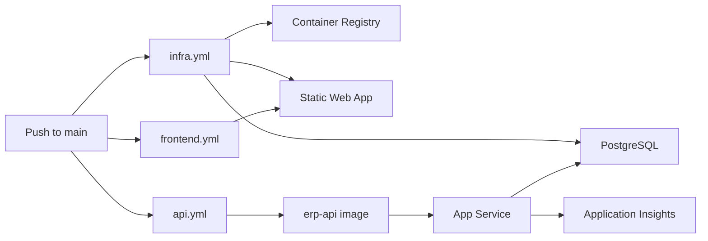
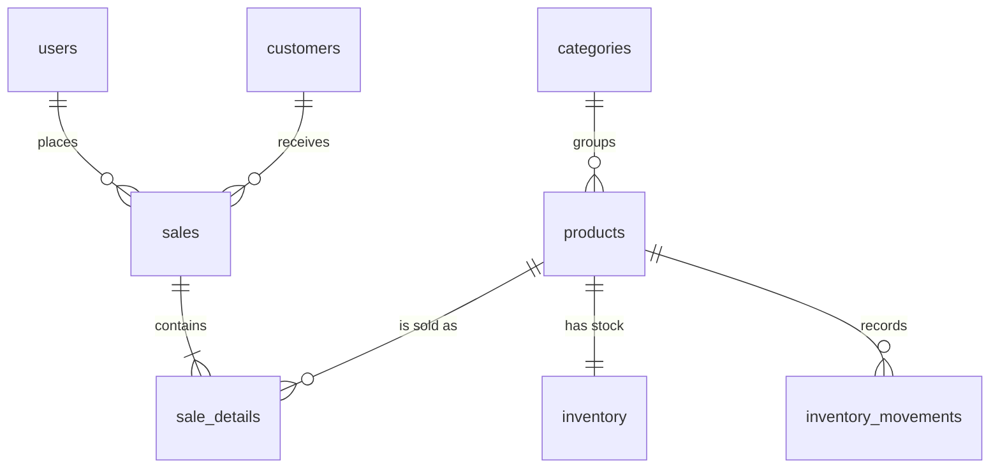

# ERP demo

A small ERP used to practice Azure infrastructure and continuous delivery. The application is a .NET 10 API, a static site, and PostgreSQL. The part that matters in this repository is how those three pieces are created and updated: Bicep in `infra/`, container image in Azure Container Registry, and three GitHub Actions workflows that deploy only the folder that changed.

Resource group: `rg-erp-demo-dev`.

| Piece | Azure resource | Region |
| --- | --- | --- |
| API | Linux App Service `app-erp-demo-dev`, plan B1, image `erp-api` | Australia Central |
| Image registry | Container Registry `acrerpdemodev` (Basic) | Central US |
| Database | PostgreSQL Flexible Server `psql-erp-demo-dev`, database `erp_db` | Central US |
| Site | Static Web App `stapp-erp-demo-dev` (Free) | Central US |
| Telemetry | Log Analytics `log-erp-demo-dev` and Application Insights `appi-erp-demo-dev` | Australia Central |

The API listens at `https://app-erp-demo-dev.azurewebsites.net`. The Static Web App public host is the default hostname Azure assigns. It is not `stapp-erp-demo-dev.azurestaticapps.net`. Read it from the resource in the portal.

Deploy commands, names, and the Postgres password rules are in [infra/README.md](infra/README.md).

## CI/CD

One GitHub repository. Workflows run on a push to `main` (a merged pull request), and only when their folder changed. Each one can also be started with **Run workflow**. Sign-in to Azure is OpenID Connect, using the secrets `AZURE_CLIENT_ID`, `AZURE_TENANT_ID`, and `AZURE_CLIENT_SUBSCRIPTION`. The database password is `POSTGRES_ADMIN_PASSWORD`. It is never written into a file.

| Workflow | Path filter | What a merge does |
| --- | --- | --- |
| [`.github/workflows/infra.yml`](.github/workflows/infra.yml) | `infra/**` | Deploys the registry, PostgreSQL (firewall open to `152.202.62.238`), and the Static Web App. It does not deploy the App Service. |
| [`.github/workflows/api.yml`](.github/workflows/api.yml) | `ERP.Backend/**` | Builds `erp-api:<commit sha>` with `az acr build` and deploys `infra/appservice.bicep` with that tag. |
| [`.github/workflows/frontend.yml`](.github/workflows/frontend.yml) | `ERP.Frontend/**` | Points `config.js` at the API on the runner, then uploads the static site. The file in git stays on `http://localhost:5080`. |

A merge that only adds files under `.github/workflows/` does not deploy anything. A merge that touches both `ERP.Backend/` and `ERP.Frontend/` runs the API and frontend workflows. A change under `infra/` runs only the infra workflow.

`infra/observability.bicep` creates the workspace, Application Insights, and diagnostic settings for the App Service and PostgreSQL. Apply it after the App Service and the database exist. The API sends request telemetry when `APPLICATIONINSIGHTS_CONNECTION_STRING` is set, which `appservice.bicep` reads from the existing Application Insights resource.



## Data model

PostgreSQL schemas match the modules: `auth`, `customers`, `catalog`, `inventory`, and `sales`. Entity Framework maps them in `ERP.Backend/ERP.Api/Data/ErpDbContext.cs`. Bicep creates an empty `erp_db`. The tables come from `dotnet ef database update`, not from the templates. The migration seeds the user `admin`.



A sale stores one header, one line, the line subtotal, and an inventory movement of type `out`. Stock is the `inventory.quantity` of that product. The sale is refused when the quantity on hand is too low. Deletes are restricted, except a sale header cascades to its lines.

## API

`ERP.Backend/ERP.Api` is one ASP.NET Core project. Module folders (`Authentication`, `Customers`, `Catalog`, `Inventory`, `Sales`) are folders, not separate services. The container image is built from `ERP.Backend/ERP.Api/Dockerfile` and listens on port 8080.

`GET /` returns `{ "name": "ERP API", "status": "ok" }` and does not require a token. Every other `/api/...` route except login requires:

```http
Authorization: Bearer dev-token
```

Login is `POST /api/auth/login` with `{ "username": "admin", "password": "dev-token" }`. The password is compared with `Auth:Token`. There is no JWT and no password-hash check. The column `auth.users.password_hash` is part of the model. The login action does not read it.

| Method | Path | Effect |
| --- | --- | --- |
| POST | `/api/auth/login` | Returns the configured token. |
| GET, POST | `/api/customers` | Lists customers, or creates one. Email is unique when present. |
| GET, POST | `/api/catalog/categories` | Lists or creates categories. |
| POST | `/api/catalog/products` | Creates a product and its inventory row. `initialQuantity` is the starting stock. |
| GET | `/api/catalog` | Lists each product with its category name and stock. |
| POST | `/api/sales` | Sells one product to one customer: `{ "customerId", "productId", "quantity" }`. |

Failed calls return `{ "error": "..." }` with status 400 or 401. CORS allows a single origin, `Frontend:Url`. Swagger is served by the API.

Configuration is environment variables. In Azure those are App Service settings: `ConnectionStrings__DefaultConnection`, `Frontend__Url`, `Auth__Username`, `Auth__Token`, and `APPLICATIONINSIGHTS_CONNECTION_STRING`. Locally, the API falls back to Postgres on `localhost:5432` and the site on `http://localhost:5500`. Copy `appsettings.Development.json.example` to `appsettings.Development.json` for the local connection string. That file is gitignored.

## Frontend

`ERP.Frontend` is static HTML, one stylesheet, and a few scripts. There is no framework. The browser never sees a database password.

- `index.html` links to the other pages.
- `login.html` stores the token from `POST /api/auth/login` in `sessionStorage`.
- `pages/customers.html` lists and creates customers.
- `pages/catalog.html` lists products, creates a category, and creates a product with a starting quantity.
- `pages/sales.html` sells one product to one customer.

`js/config.js` holds `API_URL`. `js/api.js` sends `Authorization: Bearer <token>` when a token is stored. A 401 clears the token and returns to the login page.

Locally, run the API on port 5080 and serve the site with:

```powershell
npx --yes serve "ERP.Frontend" -l 5500
```

Open `http://localhost:5500` and sign in as `admin` / `dev-token`.
